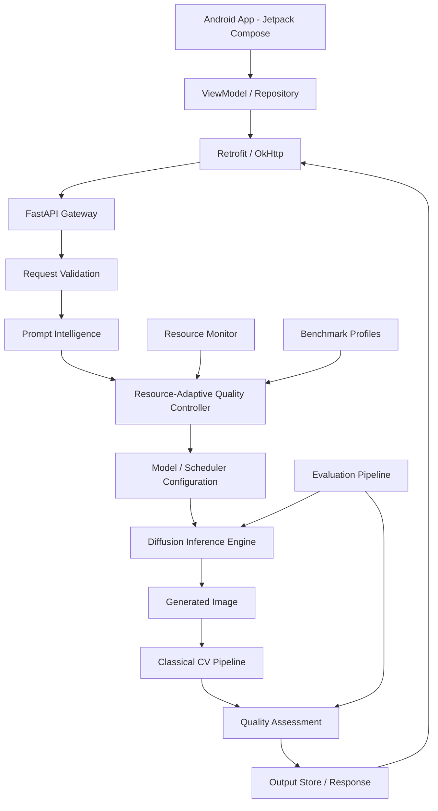

# 3. System Architecture

## 3.1 Recommended architecture

Initial recommended delivery is **Android client + Python FastAPI inference backend**. This is a hybrid architecture unless the entire generation pipeline is demonstrably executed on the Android device.



## 3.2 Main components

### Android application
- Kotlin and Jetpack Compose.
- MVVM: UI state in ViewModels; repositories own network/data operations.
- Retrofit/OkHttp for API requests.
- Prompt input, prompt examples, quality mode, resolution choice if exposed, generation progress, image result, save/share, error and retry states.
- Display selected model/configuration and measured generation time/resource data when available.
- Do not expose unsupported claims such as “generated on your phone” when the server did the work.

### FastAPI service
- Validates request schema and supported configuration.
- Coordinates prompt processing, resource selection, inference, post-processing, storage, and response.
- Returns explicit errors and trace/request IDs.
- Avoids loading duplicate pipelines for each request.
- Controls concurrency to protect limited GPU memory.

### Prompt intelligence
Extract or identify:
- Objects and approximate counts.
- Attributes such as colour, material, size, and appearance.
- Spatial relations such as beside, behind, above, below, in front of, and inside.
- Scene/environment, lighting, and style.
- Preserve original user prompt; parsed representation is supplementary.
Start with deterministic parsing/templates and evaluate whether extra language-model complexity is justified.

### Diffusion engine
Conceptual pipeline:
1. Tokenize the prompt.
2. Encode text into conditioning embeddings.
3. Initialize latent noise using seed.
4. Denoise latent over scheduler timesteps, conditioned on text embeddings.
5. Decode latent using VAE.
6. Convert to output image.
Use Diffusers-compatible model/scheduler combinations. Record exact model revision, scheduler, seed, steps, dimensions, and precision.

### Resource-Adaptive Quality Controller
Inputs:
- Available VRAM/RAM or mobile memory indicators where accessible.
- Device/backend capability profile.
- Selected quality mode.
- Requested resolution.
- Model benchmark profile.
- Optional prompt complexity indicator.

Outputs:
- Model/pipeline ID.
- Precision.
- Resolution.
- Steps/scheduler configuration.
- Expected resource band, if measured.
- Fallback-used flag and reason.

The controller is a deterministic, benchmark-informed rules engine initially. It must not claim precise future memory/latency unless a profile supports that estimate.

### Classical CV pipeline
Run after image decode and before response, with per-stage toggles/configuration for ablation. Use conservative conditional processing so already-good images are not degraded.

### Evaluation service/scripts
Offline benchmark scripts should be separate from latency-sensitive production request handling. Per-request CLIP may be optional. FID is a dataset-level statistic, not a meaningful single-image score.

## 3.3 Repository structure

```text
Imagine-AI/
├── android/
│   └── ImagineAI/
├── backend/
│   ├── app/
│   │   ├── api/
│   │   ├── schemas/
│   │   ├── services/
│   │   └── main.py
│   └── tests/
├── ai_engine/
│   ├── prompt/
│   ├── models/
│   ├── optimization/
│   ├── adaptive/
│   └── training/
├── computer_vision/
│   ├── resize/
│   ├── enhancement/
│   ├── edge_aware/
│   ├── quality/
│   └── artifacts/
├── evaluation/
│   ├── prompts/
│   ├── scripts/
│   ├── results/
│   └── reports/
├── datasets/
│   └── README.md
├── model_artifacts/
│   └── README.md
├── tests/
├── docs/
├── ai_handoff/
├── .env.example
├── .gitignore
├── requirements.txt
├── Dockerfile
└── README.md
```

## 3.4 Runtime and hardware constraints
Development machine target: RTX 5050 Laptop GPU (~8 GB VRAM), 24 GB system RAM. VRAM and system RAM are different resources. Start with one loaded pipeline, one generation at a time, and conservative resolution. Profile before increasing concurrency.

Use `nvidia-smi` and, where useful, `watch -n 1 nvidia-smi`. Record driver, CUDA, PyTorch, OS, CPU, RAM, GPU, model revision, and library versions in benchmark reports.

## 3.5 Network topology
When Android calls a backend running on the laptop, use the laptop's reachable LAN IP, not `localhost` on the phone. Confirm both devices can reach each other. Configure Android internet permission and a development-only cleartext policy only if required. Do not ship insecure development networking as production configuration.
