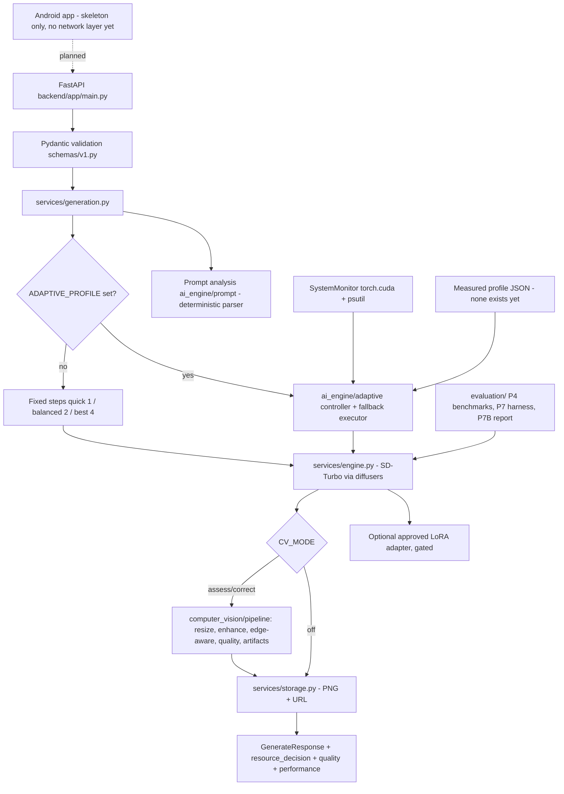

# Architecture (as implemented in this repo)

Deployment label today: **hybrid / laptop-hosted backend** at most. Nothing runs on the phone. No cloud host exists. Do not present generation as "on-device".

## Endpoints (API v1.0.0, not yet signed off by both developers)
`GET /health`, `GET /api/v1/capabilities`, `GET /api/v1/model`, `POST /api/v1/generate`, `POST /api/v1/prompt/analysis`.

## Order of operations in `generate()`
controller (or fixed steps) -> engine -> optional CV hook -> save once -> response. Hand-merged during the combined-tree merge (`MERGE_NOTES.md` section 2); exercised only with fakes.

## Opt-in switches (all default to the P1A baseline)
`PRECISION, ATTENTION_SLICING, VAE_SLICING, OFFLOAD, WEIGHTS_VARIANT` (P4); `CV_MODE=off|assess|correct` (P5B); `ADAPTIVE_PROFILE/POLICY/ALLOW_SYNTHETIC/DECISION_LOG` (P6); `ADAPTER_PATH` (P3B); `MODEL_REVISION`, `PRELOAD_MODEL`.
